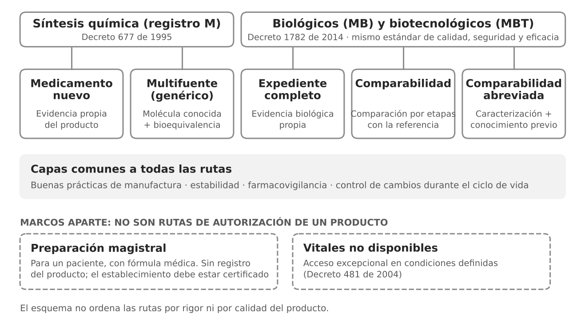

Toda ruta de autorización responde la misma pregunta: ¿hay confianza suficiente en la calidad, la seguridad y la eficacia del producto? Lo que cambia es de dónde sale esa confianza.

## Medicamentos de síntesis química

- **Nuevo:** el fabricante presenta estudios propios del producto, preclínicos y clínicos.
- **Multifuente (genérico):** no repite los ensayos de eficacia. Se apoya en el conocimiento establecido de la molécula y demuestra equivalencia farmacéutica y, cuando la norma lo exige, bioequivalencia. La bioequivalencia no se exige para todos los productos.

## Medicamentos biológicos

Las tres rutas exigen el mismo estándar de calidad, seguridad y eficacia; cambia la composición de la evidencia.

- **Expediente completo:** estudios propios, como un medicamento nuevo.
- **Comparabilidad:** comparación escalonada con un producto de referencia (analítica, funcional, farmacocinética y, si quedan dudas, clínica). Se busca demostrar que no hay diferencias clínicamente relevantes.
- **Comparabilidad abreviada:** permite reducir ciertas etapas con justificación científica, apoyándose en la caracterización del producto y en un conocimiento previo extenso. La autoridad puede pedir más evidencia.

## Lo que conviene retener

La cantidad de ensayos clínicos propios no indica por sí sola el rigor de una evaluación. Un biosimilar con pocos ensayos clínicos puede tener una caracterización analítica muy exhaustiva. Al revés, una ruta abreviada no garantiza que toda la incertidumbre quede resuelta. Las preguntas útiles son qué evidencia sustenta la autorización, qué incertidumbre buscaba resolver y cuál queda.
