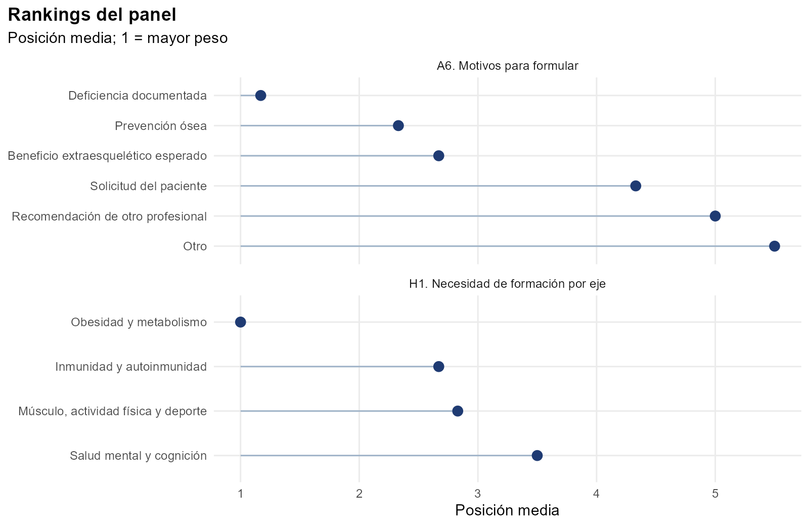
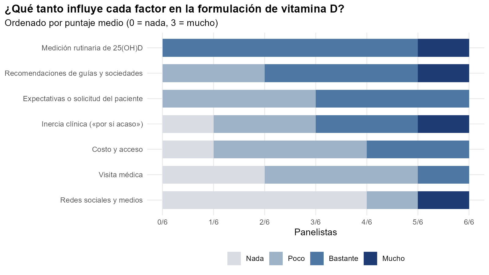
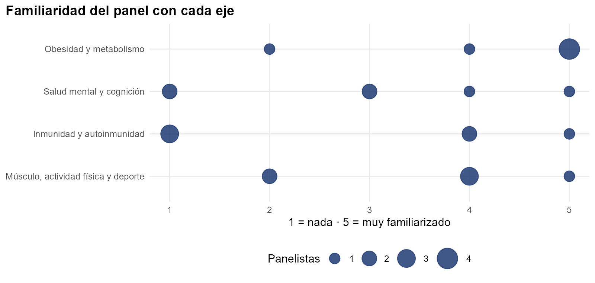
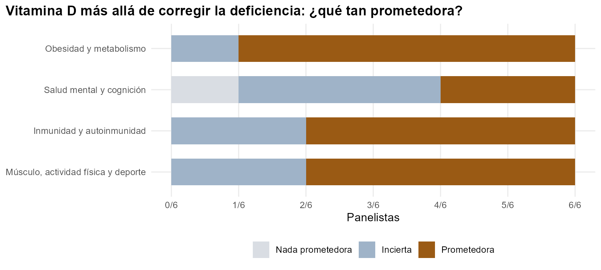
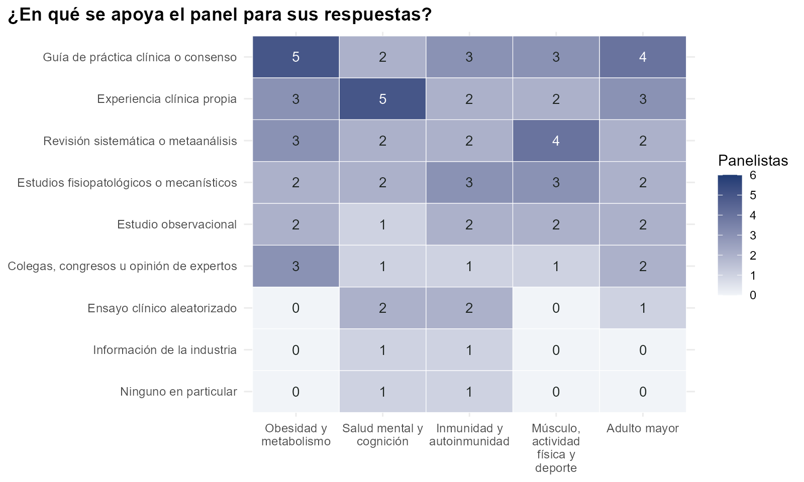

La medición rutinaria de 25(OH)D es lo que más impulsa la formulación en el panel: los seis le dan un peso de «bastante» o «mucho». Es justo la práctica que las guías recientes desaconsejan (ficha [T3a](../t3a/)). El eje de obesidad y metabolismo es el que más conocen, el que más prometedor ven y el primero que priorizan para formación.

Respondieron 6 de los 7 miembros de la mesa, entre el 28 de octubre y el 4 de noviembre de 2026. El doctor Andrés Felipe Coy Barrera participa en la discusión sin votar. Los códigos entre paréntesis (A4, F1, G2…) remiten a las preguntas del formulario.

## Quiénes respondieron

Respondieron tres especialistas en endocrinología, uno en medicina del deporte, una en geriatría y uno en psiquiatría. Cuatro tienen entre 10 y 20 años de práctica y dos más de 20. Los seis ejercen en práctica privada, cuatro también en la académica y una en la pública (A2, A3).

## Cómo formulan hoy

| Aspecto | Respuesta del panel |
| --- | --- |
| Frecuencia de formulación (A4) | 4 de 6 formulan con frecuencia; 2, de vez en cuando |
| Medición de 25(OH)D antes de formular (A5) | 5 de 6 la piden casi siempre o siempre |
| Principal motivo (A6) | Deficiencia documentada: primer lugar para 5 de 6 |
| Esquema más usado (A7) | Depende del paciente (4); semanal (2) |
| Umbral para tratar (G1) | <10 ng/mL (2), <20 ng/mL (2), <30 ng/mL (1), depende del paciente (1) |
| Dosis altas intermitentes (G2) | Las usan los seis: cinco de vez en cuando y uno como esquema habitual |
| Qué les preocupa de los bolos (G4) | Caídas o fracturas (4), hipercalcemia o hipercalciuria (2) |
| Control durante el tratamiento (G5) | 25(OH)D de control (6), calcio sérico (3), función renal (3) |

## Qué impulsa la formulación

Después de la medición rutinaria vienen las recomendaciones de guías y sociedades, con «bastante» o «mucho» peso para 4 de 6. Las expectativas del paciente y la inercia clínica («por si acaso») pesan bastante para la mitad. La visita médica y las redes sociales son lo que menos influye (F1).

## Familiaridad y expectativas por eje

El panel conoce bien obesidad y metabolismo (mediana 5 de 5) y músculo y deporte (mediana 4). Conoce menos salud mental (mediana 3) e inmunidad (mediana 2,5); en inmunidad, tres panelistas se calificaron con 1 o 2 (B0, C0, D0, E0).

Sobre el uso de la vitamina D más allá de corregir la deficiencia, cinco de seis ven prometedor el eje de obesidad y metabolismo. Cuatro de seis ven prometedores la inmunidad y el músculo, y solo dos la salud mental (H5).

## En qué se apoyan

Las guías y los consensos son el principal apoyo en obesidad (5 de 6) y en el adulto mayor (4). La experiencia clínica propia domina en salud mental (5) y las revisiones sistemáticas en músculo (4). Casi nadie se apoya en ensayos clínicos: ninguno en obesidad ni en músculo.

## Lo que esto plantea frente a la evidencia

| Lo que dice el panel | Lo que muestra la evidencia | Ficha |
| --- | --- | --- |
| La medición rutinaria es lo que más mueve la formulación | Las guías recientes no recomiendan medir de rutina en adultos sin indicación | [T3a](../t3a/) |
| Todos usan bolos de vez en cuando y cuatro temen sus efectos | Los bolos no previenen caídas ni fracturas, y con dosis muy altas hubo más | [T1](../t1/) |
| Obesidad es el eje más prometedor | El beneficio clínico sólido está en prediabetes; en obesidad hay mejoras de nivel sin beneficio clínico | [T6](../t6/), [T4a](../t4a/) |
| Músculo es prometedor para 4 de 6 | Sola no mejora masa ni fuerza; con proteína y ejercicio hay señal | [T7](../t7/) |
| Salud mental genera dudas | Efecto pequeño y de corto plazo en depresión | [T9](../t9/) |

## Formación médica continuada

Los seis señalan la medicina general como el público prioritario, y cinco de seis también la medicina familiar. Los seis prefieren talleres de casos clínicos; la mitad también webinars o simposios en congresos. Cinco de seis están dispuestos a participar en proyectos, como conferencistas o en ambas funciones (H2, H3, H6).
